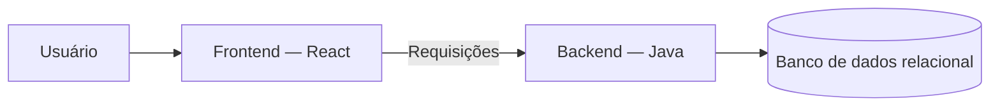

# Arquitetura Proposta

## Diretriz
O documento de requisitos recomenda React no frontend, Java no backend e banco de dados relacional, com separação de responsabilidades. Esta é uma arquitetura prevista, não uma implementação já existente.



## Responsabilidades
- **Frontend:** interface, formulários, consultas, visualização de estoque, histórico e alertas.
- **Backend:** regras de negócio, validações, movimentações e acesso aos dados.
- **Banco relacional:** persistência dos funcionários, tipos de EPI e movimentações.

## Módulos funcionais propostos
Funcionários; tipos de EPI; estoque; entregas; devoluções; validade.

## Estrutura conceitual sugerida
```text
EPI-Manager/
├── README.md
├── docs/
│   ├── arquitetura.md
│   ├── diagramas-uml.md
│   ├── requisitos.md
│   └── regras-de-negocio.md
├── backend/   (aplicação Java a implementar)
└── frontend/  (aplicação React a implementar)
```

As pastas backend e frontend são uma sugestão de organização e ainda não contêm aplicações.

## Cuidados derivados dos requisitos
- Manter integridade dos saldos mesmo em falhas (RNF03).
- Preservar movimentações confirmadas (RN10).
- Não excluir fisicamente funcionários e tipos de EPI com movimentações (RN13).
- Exibir mensagens compreensíveis sem expor detalhes técnicos (RNF07).

## Decisões pendentes
Versões de Java e React, framework backend, banco relacional, modelo de dados, contrato da API, autenticação/autorização, testes e implantação. Esses pontos não estão definidos integralmente no documento-base.