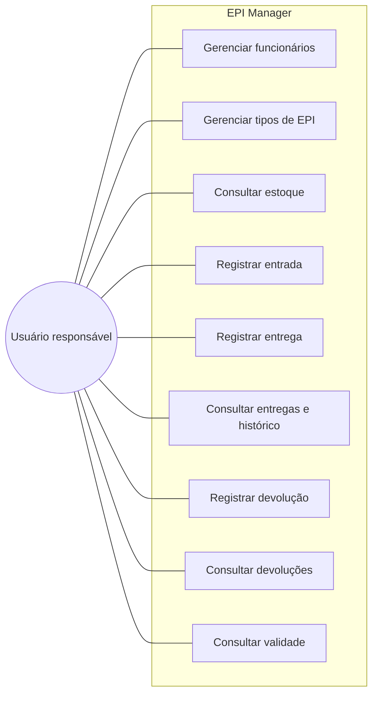
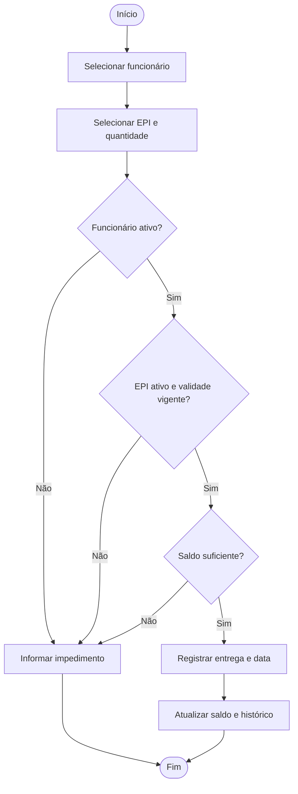
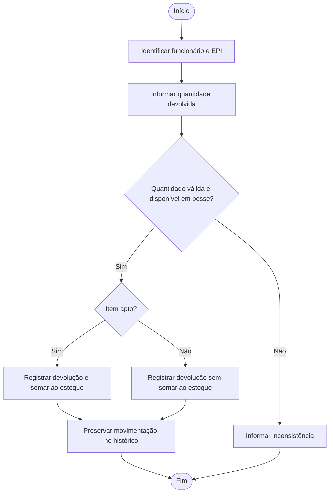
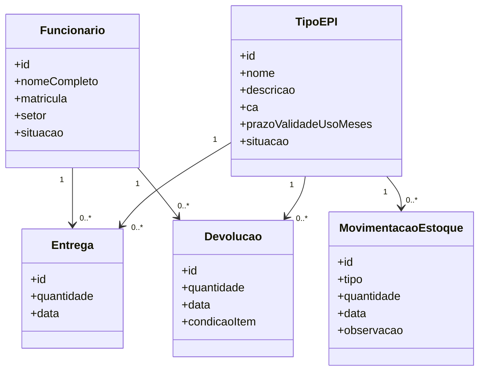
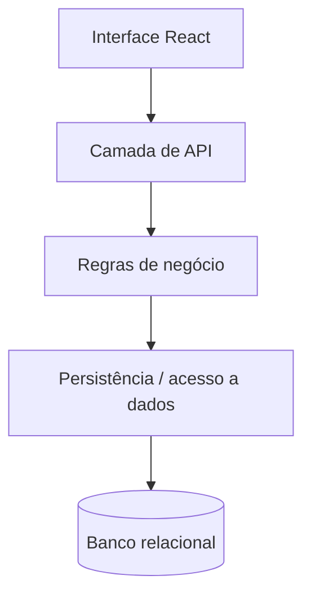
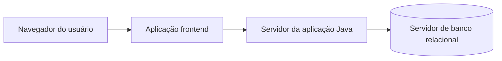

# Diagramas UML — EPI Manager

Os diagramas são representações iniciais para apoiar a modelagem, com base nos requisitos do documento. Devem ser revisados e detalhados; não substituem a validação formal.

## 1. Casos de uso — visão geral

O ator é genérico; o documento-base não define níveis distintos de acesso.

## 2. Atividade — entrega

## 3. Atividade — devolução

## 4. Classes — modelo conceitual inicial

Atributos, tipos, chaves e cardinalidades são preliminares e deverão ser refinados.

## 5. Componentes — visão proposta

## 6. Implantação — visão lógica

Hospedagem, rede e infraestrutura ainda não foram definidas.